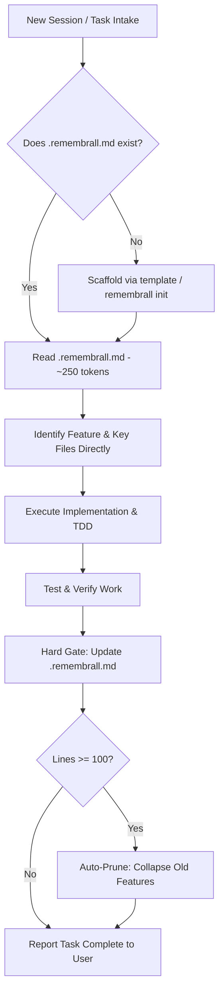

# Remembrall

> **Persistent external memory and zero-rescan state engine for autonomous AI coding agents.**  
> Inspired by Manus AI disk persistence (`planning-with-files`), `auto-memory-pro` anti-bloat curation, and standard Model Context Protocol (MCP).



---

## Core Principle

**Never re-scan the entire codebase from scratch when the state is already recorded on disk.**  
The file `.remembrall.md` in the project root is the single source of truth for active project state, completed features, and key architecture decisions.

---

## Zero Re-scan Protocol

Before exploring files or answering questions about *"what has been built so far"*:
1. **Read `.remembrall.md` first:** Execute `read_file` on `.remembrall.md` at the project root.
2. **Consult Feature Manifest:** Look up the requested feature in the table:
   - If marked `DONE`, read only the listed `File Terkait` (Key Files) directly.
   - Do NOT run blind recursive directory searches or massive greps.
3. **If `.remembrall.md` does not exist (Cold Start):**
   - Initialize it immediately using the CLI:
     ```bash
     python .agents/skills/remembrall/scripts/remembrall.py init --template minimal
     ```
   - Or scaffold from the starter template.

---

## Update Protocol

Before announcing any task or feature as complete:
1. **Update the Manifest Table:**
   - Change feature status from `WIP` to `DONE`.
   - Ensure `File Terkait` lists the exact primary files created or modified.
   - Provide a concise (1-line) summary note.
   - *Via CLI:*
     ```bash
     python .agents/skills/remembrall/scripts/remembrall.py set F-003 DONE --notes "Feature finalized and verified"
     ```
2. **Record Critical Decisions:**
   - If a major technical choice or gotcha was discovered (e.g. library constraint, schema decision), add one bullet to `## Technical Findings`.
3. **Hard Gate:**
   - You MUST NOT state to the user that work is finished without verifying that `.remembrall.md` reflects the latest state.

---

## Anti-Bloat & Pruning Policy

To prevent `.remembrall.md` from expanding into a token-wasting novel:
- **Maximum Line Budget:** Strict ceiling of **120 lines**.
- **Pruning Trigger:** Whenever the file reaches 100 lines:
  - Run the automated pruning script:
    ```bash
    python .agents/skills/remembrall/scripts/remembrall.py prune
    ```
  - This collapses 5–10 historical `DONE` features into a single summary row:
    `| F-001..F-008 | Core Foundations | DONE | src/auth/, src/db/ | Stabilized historical features |`

---

## Sync Protocol

When the user modifies code manually outside AI or requests a memory refresh:
1. Run `git status --short` or inspect recently modified files.
2. Compare discovered files against `.remembrall.md`.
3. Reconcile any mismatched statuses (`WIP` vs `DONE`) or missing file paths.
4. **Git Conflict Resolution:** If merge conflict markers (`<<<<<<< HEAD`) appear, keep both rows if feature IDs differ, or keep the `DONE` status if they refer to the same completed work.
5. Confirm to user: *"Remembrall manifest synchronized with workspace."*

---

## Red Flags & Rationalization Traps

| Rationalization Thought | Reality |
|---|---|
| *"I can just grep the whole repo quickly"* | Broad greps waste 5,000–15,000 tokens. Check `.remembrall.md` first. |
| *"The task was trivial, I will skip updating the manifest"* | State drift accumulates. Hard gate requires updating the table on every task. |
| *"I will write detailed multi-paragraph notes into the manifest"* | Manifest will bloat. Keep notes strictly to 1 concise line per feature. |
| *"I remember what was done without checking"* | In long sessions, context degrades. Ground your bearings in the physical manifest. |

---

## Complete Tooling Reference

| Command | Purpose | Example |
|---|---|---|
| `ui` | Launch local dark-mode web dashboard | `python scripts/remembrall.py ui` |
| `semantic` | Vector similarity & concept search | `python scripts/remembrall.py semantic "login session"` |
| `query` | Weighted keyword search | `python scripts/remembrall.py query "auth"` |
| `simulate` | Benchmark token and latency savings | `python scripts/remembrall.py simulate --turns 20` |
| `export` | Generate changelog or release notes | `python scripts/remembrall.py export --format changelog` |
| `status` | Print health check & token usage | `python scripts/remembrall.py status` |
| `add` | Append a new feature row safely | `python scripts/remembrall.py add "Auth API" "src/auth.py"` |
| `set` | Update status or notes by ID | `python scripts/remembrall.py set F-002 DONE` |
| `prune` | Collapse older DONE rows to save tokens | `python scripts/remembrall.py prune --threshold 8` |
| `validate` | Enforce line limits & table integrity | `python scripts/remembrall.py validate` |
| `install-hooks`| Install git pre-commit hook | `python scripts/remembrall.py install-hooks` |
| `init` | Scaffold new manifest from templates | `python scripts/remembrall.py init --template web` |
