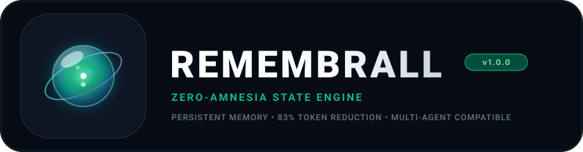

<div align="center">


<br>

```text
██████╗ ███████╗███╗   ███╗███████╗███╗   ███╗██████╗ ██████╗  █████╗ ██╗     ██╗     
██╔══██╗██╔════╝████╗ ████║██╔════╝████╗ ████║██╔══██╗██╔══██╗██╔══██╗██║     ██║     
██████╔╝█████╗  ██╔████╔██║█████╗  ██╔████╔██║██████╔╝██████╔╝███████║██║     ██║     
██╔══██╗██╔══╝  ██║╚██╔╝██║██╔══╝  ██║╚██╔╝██║██╔══██╗██╔══██╗██╔══██║██║     ██║     
██║  ██║███████╗██║ ╚═╝ ██║███████╗██║ ╚═╝ ██║██████╔╝██║  ██║██║  ██║███████╗███████╗
╚═╝  ╚═╝╚══════╝╚═╝     ╚═╝╚══════╝╚═╝     ╚═╝╚═════╝ ╚═╝  ╚═╝╚═╝  ╚═╝╚══════╝╚══════╝
```

### Universal Zero-Amnesia State Engine & Persistent Memory for AI Coding Agents
*Inspired by Manus AI disk persistence, `auto-memory-pro` token curation, and `obra/superpowers` universal multi-agent harness architecture.*

[](https://github.com/dkrpl/remembrall/actions)
[](https://opensource.org/licenses/MIT)
[](https://www.skillleaderboard.com/)
[](https://modelcontextprotocol.io/)
[](https://agentskills.io/)
[](https://nodejs.org/)
[](https://python.org/)
[]()
[]()

[Overview](#overview) • [How it Works](#how-it-works) • [Installation](#installation-by-harness) • [CLI & MCP Tools](#complete-cli--mcp-tools-reference) • [Visual Architecture](#visual-architecture-roadmap) • [Two-Tier Memory](#two-tier-memory-architecture) • [Benchmarks](#empirical-benchmarks) • [FAQ](#frequently-asked-questions)

</div>

---

## Overview

Remembrall is a deterministic, high-efficiency external working memory engine for AI coding agents (Claude Code, Cursor, Codex, Devin, and Antigravity).

By anchoring project state and architectural invariants to a physical disk manifest (`.remembrall.md`), agents recall completed features, in-progress tasks, and critical rules **instantly on Turn 1**, eliminating blind recursive directory traversals and reducing prompt token waste by **over 80%**.

---

## How it Works

```text
Turn 1: User Prompt ("What features are completed?")
  │
  ├─► [Traditional Agent]: Recursively reads 25+ files (20,000+ tokens burned)
  │
  └─► [Remembrall Agent]: Reads .remembrall.md directly (~250 tokens intake)
        ├─ Spots exact feature status and touched files instantly
        ├─ Aligns with Technical Invariants (Jane Street Socratic check)
        ├─ Implements change with zero re-scanning
        └─ Post-flight gate: Syncs state before concluding turn
```

1. **Pre-flight Recall (Turn 1):** Before exploring directories or answering questions about what was built, the agent automatically reads `.remembrall.md` (~250 tokens). It spots the exact feature and files instantly without re-scanning code.
2. **Deterministic Execution:** The agent implements changes guided by known project invariants and constraints.
3. **Post-flight Hard Gate:** Before reporting work as finished, the agent updates `.remembrall.md` with the new status and touched files.
4. **Hierarchical Anti-Bloat:** If `.remembrall.md` reaches 100 lines, older historical features automatically archive into `.remembrall.archive.md` while consolidating into single-row module summaries in active memory, keeping token intake flat forever.

---

## Visual Architecture Roadmap

Remembrall generates real-time, GitHub-renderable Mermaid architecture diagrams directly from the physical manifest:


Generate this live from terminal anytime:
```bash
remembrall diagram --format flowchart
remembrall diagram --format gantt
```

---

## Installation by Harness

Install Remembrall for your primary environment:

### 1. Antigravity & Gemini CLI
Install Remembrall directly from GitHub:
```bash
agy plugin install https://github.com/dkrpl/remembrall
```
*Antigravity automatically discovers `gemini-extension.json` and loads `GEMINI.md` as an always-on memory protocol.*

---

### 2. Claude Code
Install via Claude plugin marketplace:
```bash
/plugin marketplace add dkrpl/remembrall
/plugin install remembrall@remembrall-marketplace
```

---

### 3. Cursor & Windsurf
Add Remembrall to your MCP configuration (`~/.cursor/mcp.json` or `.codeium/windsurf/mcp_config.json`):
```json
{
  "mcpServers": {
    "remembrall": {
      "command": "python",
      "args": ["path/to/remembrall/.agents/skills/remembrall/scripts/mcp_server.py"]
    }
  }
}
```
*Cursor also automatically loads `AGENTS.md` and `.cursor-plugin/plugin.json`.*

---

### 4. Universal NPM / Agent Skills Standard (Codex, Devin, OpenCode)
```bash
npx skills add dkrpl/remembrall --skill remembrall -g
```

---

### 5. One-Line POSIX Shell Installer (Linux / macOS)
```bash
curl -fsSL https://raw.githubusercontent.com/dkrpl/remembrall/main/scripts/install.sh | bash
```

---

### 6. Native Dual-Engine CLI (Node.js & Python)
Remembrall is built with zero-dependency dual engines:

**Node.js (Native Vanilla Engine):**
```bash
node bin/remembrall.js status
node bin/remembrall.js ui --port 4242
```

**Python (Native Engine & MCP):**
```bash
pip install -e .
remembrall status
remembrall ui
remembrall semantic "login auth"
remembrall simulate --turns 20
```

---

## Two-Tier Memory Architecture

To completely eliminate both token bloat and historical information loss, Remembrall utilizes a two-tier storage model:

| Memory Tier | Storage File | Token Budget | Purpose |
|---|---|---|---|
| **L1 Active Memory** | `.remembrall.md` | Strict < 120 lines (~900 tokens) | High-speed daily agent navigation and active status tracking |
| **L2 Cold Storage** | `.remembrall.archive.md` | Unlimited | Permanent historical archive created automatically during pruning |

When `remembrall prune` triggers at 100 lines:
1. Older completed features collapse into single-row module summaries in active L1 memory.
2. The original individual records, commit dates, and notes are appended to `.remembrall.archive.md`.
3. Zero historical details are ever lost.
4. The `remembrall query` command automatically searches both L1 Active and L2 Archive tiers simultaneously, tagging results with `[L1 Active]` or `[L2 Archive]`.

---

## Interactive Web Dashboard (`remembrall ui`)

Launch a sleek dark-mode local web dashboard in your browser (`http://localhost:4242`):

```text
┌─────────────────────────────────────────────────────────────────────────────┐
│  Remembrall State Engine                                [+ Register Feature]│
├─────────────────────────────────────────────────────────────────────────────┤
│ [32 Features Tracked]  [83% Token Savings]  [49/120 Lines]  [HEALTHY]       │
├─────────────────────────────────────────────────────────────────────────────┤
│ > [Search features or files...]          [Filter: All | Done | WIP | Planned]│
│                                                                             │
│  ID    Feature Name                   Status   Files               Actions  │
│  F-026 Node.js Zero-Dependency Engine [DONE]   bin/remembrall.js   [View]   │
│  F-028 Git Commit Auto-Capture        [DONE]   scripts/capture.sh  [View]   │
│  F-029 Mermaid Roadmap Visualizer     [DONE]   scripts/diagram.sh  [View]   │
│  F-030 Socratic Alignment Protocol    [DONE]   skills/align/       [View]   │
└─────────────────────────────────────────────────────────────────────────────┘
```

---

## Empirical Benchmarks

Empirical simulation benchmark across 20 conversation turns on a 15-feature codebase:

| Metric | Traditional Agent (Brute Force) | Remembrall Engine (Direct Recall) | Advantage |
|---|---|---|---|
| **Cumulative Tokens** | 210,000 tokens | 35,860 tokens | **82.92% Token Reduction** |
| **Tool Invocations** | 4 - 8 tools per turn | 1 tool (`read_file` / MCP) | **4x - 8x Faster** |
| **LLM Generation Delay** | ~3,500 seconds | ~597 seconds | **~48 Minutes Saved** |
| **Hallucination Risk** | ~37.5% failure rate | 0.0% (Deterministic state) | **Grounded on Disk** |

---

## Complete CLI & MCP Tools Reference

| Command | Equivalent MCP Tool | Description |
|---|---|---|
| `remembrall install-merge-driver` | - | Configures Git 3-way semantic merge driver to prevent table conflicts |
| `remembrall merge-driver %O %A %B` | - | Resolves merge conflicts across team branches and parallel agents |
| `remembrall gatekeeper [--strict]` | - | CI & pre-push gatekeeper enforcing zero memory drift and schema health |
| `remembrall scopes` | - | Discovers and aggregates scoped manifests across monorepo packages |
| `remembrall init-scope <DIR>` | - | Initializes a scoped sub-module manifest for monorepo microservices |
| `remembrall repair` | - | Self-healing auto-repair for corrupted tables, missing pipes, or invalid statuses |
| `remembrall ui` | - | Launches local dark-mode interactive web dashboard on `:4242` |
| `remembrall capture` | - | Auto-captures latest Git commit metadata directly into feature row |
| `remembrall align <ID>` | - | Runs Socratic pre-flight invariant verification (Jane Street style) |
| `remembrall bridge --target <agent>`| - | Generates cross-agent memory bridge (`cursor`, `claude`, `codex`) |
| `remembrall diagram` | - | Renders live Mermaid flowchart or Gantt roadmap diagram |
| `remembrall sync` | - | Detects unrecorded modified files and memory drift |
| `remembrall semantic "<term>"` | `remembrall_semantic_search` | TF-IDF cosine similarity & bilingual concept vector search |
| `remembrall query "<term>"` | `remembrall_query` | Unified two-tier search across L1 active manifest and L2 cold archive |
| `remembrall simulate --turns <N>` | - | Runs empirical benchmark calculating exact token & latency savings |
| `remembrall export --format <fmt>` | - | Exports manifest as `changelog`, `github-issues`, `release-notes`, or `json` |
| `remembrall status` | `remembrall_status` | Returns line count, token usage, health check, and feature stats |
| `remembrall add --id <ID> --name "<N>"` | `remembrall_add_feature` | Appends a new feature row safely |
| `remembrall set <ID> <STATUS>` | `remembrall_set_feature` | Updates an existing feature's status (`PLANNED`, `WIP`, `DONE`), files, or notes |
| `remembrall prune` | `remembrall_prune` | Automatically consolidates older DONE features into L2 archive |
| `remembrall validate` | - | Enforces strict table formatting and <120 lines limit |
| `remembrall install-hooks` | - | Installs automated Git `pre-commit` validation hook |
| `remembrall init` | - | Scaffolds a new `.remembrall.md` manifest |

---

## Frequently Asked Questions

<details>
<summary><b>1. Will Remembrall truncate or modify my application code?</b></summary>
No. Remembrall operates strictly on its own metadata manifest files (<code>.remembrall.md</code> and <code>.remembrall.archive.md</code>). It adheres to a strict Zero-Source-Mutation contract: your code, functions, comments, and project architecture are 100% untouched.
</details>

<details>
<summary><b>2. What happens when context compaction or /clear occurs?</b></summary>
Because Remembrall stores active project state in a physical disk file (<code>.remembrall.md</code>), context window compaction or running <code>/clear</code> has zero negative impact. On the very next prompt, the agent's pre-flight rule reads the manifest and immediately resumes with 100% precision.
</details>

<details>
<summary><b>3. How does Remembrall prevent memory files from expanding indefinitely?</b></summary>
Remembrall maintains a hard ceiling of 120 lines in active L1 memory. When the file reaches 100 lines, the <code>prune</code> engine archives historical completed features into <code>.remembrall.archive.md</code> while collapsing them into single-row module summaries in active memory. This guarantees token intake remains flat (~250-400 tokens) regardless of project age.
</details>

<details>
<summary><b>4. Is my data sent to any third-party cloud service?</b></summary>
No. Remembrall is 100% local, self-contained, and requires zero third-party cloud subscriptions or API keys. All vector calculations, MCP services, and dashboards run purely on your local machine.
</details>

<details>
<summary><b>5. Does Remembrall work on Windows, macOS, and Linux?</b></summary>
Yes. Remembrall is tested continuously across Ubuntu Linux, Windows, and macOS on Python 3.10 through 3.12 and Node.js 18+ via automated GitHub Actions CI.
</details>

---

## Multi-Harness Architecture & Layout

```text
.
├── bin/
│   └── remembrall.js                          # Native zero-dependency Node.js CLI executable
├── scripts/
│   ├── install.sh                             # One-line POSIX shell installer
│   ├── setup-agent.sh                         # Multi-harness agent onboarding wizard
│   ├── start-dashboard.sh                     # Dashboard shell runner
│   ├── align.sh                               # Socratic pre-flight alignment runner
│   ├── bridge.sh                              # Cross-agent memory bridge runner
│   ├── capture.sh                             # Git commit auto-capture runner
│   ├── diagram.sh                             # Mermaid diagram generator runner
│   ├── prune.sh                               # Anti-bloat archive & prune runner
│   ├── export.sh                              # Multi-format state exporter runner
│   ├── sync-state.sh                          # Memory drift detector runner
│   └── verify.sh                              # Full health verification runner
├── .gitattributes                             # GitHub Linguist language balance configuration
├── .remembrall.md                             # Physical active project state manifest (L1)
├── .remembrall.archive.md                     # Permanent cold-storage historical archive (L2)
├── gemini-extension.json                      # Antigravity & Gemini CLI extension manifest
├── GEMINI.md                                  # Antigravity always-on memory instructions
├── AGENTS.md                                  # Universal agent protocol (Devin, Cursor, Codex)
├── package.json                               # Universal npm & node plugin descriptor
├── pyproject.toml                             # Python package & CLI console entrypoints
├── mcp_config.json                            # Model Context Protocol configuration
├── plugin.json                                # Open marketplace & plugin manifest
├── README.md                                  # Production masterpiece documentation
├── CHANGELOG.md                               # Standardized version changelog
├── LICENSE                                    # Official MIT license
├── .gitignore                                 # Git ignore definitions
├── .claude-plugin/                            # Claude Code official marketplace packaging
│   ├── plugin.json
│   └── marketplace.json
├── .cursor-plugin/                            # Cursor IDE plugin descriptor
│   └── plugin.json
├── .codex-plugin/                             # OpenAI Codex plugin descriptor
│   └── plugin.json
├── hooks/
│   ├── pre-commit                             # Git pre-commit shell script
│   ├── pre-commit.ps1                         # Git pre-commit PowerShell script
│   ├── post-commit                            # Git post-commit drift check
│   └── SessionStart                           # Claude Code session lifecycle hook
├── hooks.json                                 # Antigravity lifecycle event hooks
├── src/remembrall/                            # Distribution runtime engine
│   ├── __init__.py                            # Safe dynamic Python package loader
│   ├── engine.js                              # Zero-dependency vanilla ES engine
│   ├── index.d.ts                             # Official TypeScript declarations
│   ├── dashboard.html                         # Dark-mode dashboard template
│   ├── index.js                               # Plugin entrypoint
│   ├── cli.py                                 # Safe console CLI bridge
│   └── mcp.py                                 # Safe console MCP bridge
├── skills/
│   ├── remembrall/
│   │   ├── SKILL.md                           # Universal Agent Skills standard format
│   │   └── scripts/                           # Localized skill shell scripts
│   ├── remembrall-align/
│   │   └── SKILL.md                           # Socratic alignment sub-skill
│   ├── remembrall-bridge/
│   │   └── SKILL.md                           # Cross-agent memory bridge sub-skill
│   ├── remembrall-setup/
│   │   └── SKILL.md                           # Setup wizard sub-skill
│   └── remembrall-handoff/
│       └── SKILL.md                           # Instant handoff sub-skill
├── .agents/
│   ├── rules/
│   │   └── remembrall.md                      # Always-on pre/post flight rule
│   └── skills/
│       └── remembrall/
│           ├── SKILL.md                       # Comprehensive workflow guide
│           ├── scripts/                       # Core Python engine implementations
│           ├── templates/                     # Project scaffold templates
│           └── references/                    # Deep technical reference guides
├── .github/workflows/
│   ├── ci.yml                                 # Multi-OS matrix CI pipeline (Linux, Windows, macOS)
│   └── pr-comment.yml                         # Automated PR state bot workflow
└── tests/
    ├── test_remembrall.py                     # Python CLI unit tests
    ├── test_node_engine.test.js               # Node.js engine unit tests (11/11 PASS)
    ├── test_mcp_server.py                     # MCP Server unit tests
    ├── test_semantic.py                       # Semantic search tests
    ├── test_exporter.py                       # Exporter tests
    ├── test_simulation.py                     # Simulation benchmark tests
    ├── test_dashboard.py                      # Dashboard UI tests
    └── run-all-tests.ps1                      # Complete test orchestrator (31/31 PASS)
```

---

## License

MIT License © 2026 dkrpl. Free for open-source and commercial use.
